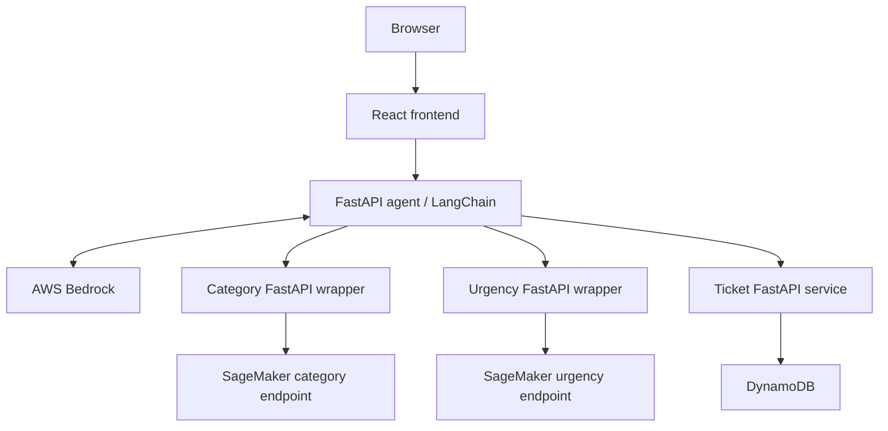

# PropPilot AI

An intelligent maintenance assistant for property managers. Built as an individual AI, Cloud, and DevOps capstone by Anthony Carlock, with AI development assistance.

## Current status

The category baseline, containerized FastAPI service, and first SageMaker serverless endpoint are implemented and verified. Four real cloud predictions passed through the wrapper; see [deployment instructions and evidence](docs/sagemaker-deployment.md). The local Compose service still defaults to local inference.

The React dashboard and Bedrock/LangChain workflow are verified through a real Chrome browser: React → agent → two SageMaker endpoints → saved assessment → explicit ticket confirmation → DynamoDB. Open http://127.0.0.1:8080 while the local demo services are running. See [frontend setup](frontend/README.md), [ticket workflow](services/tickets/README.md), and [browser verification evidence](docs/frontend-verification.json).

Start the complete staging stack with `.venv/bin/python scripts/compose_up.py --staging` (authorized AWS profile required). All five application services run in Docker; development uses local models via the same command without `--staging`. See [Compose setup and credential handling](docs/compose.md). Tickets persist across refresh/restart; chat/request activity is session-only. The shared development workspace has no authentication or tenant isolation and uses fictional data.

The model uses 48 synthetic training examples and 16 held-out examples, with macro F1 0.803 (13/16 correct). These results do not establish real-world reliability. See [training instructions](ml/README.md), [evaluation report](ml/evaluation/category-baseline.json), and [API setup](services/category/README.md).

Both category and urgency now run on independent SageMaker endpoints. The chat tool calls both APIs concurrently; the dashboard displays model urgency and recommended priority. Explicit caller-confirmed hazards can raise the recommendation without rewriting the model prediction, and all urgency assessments require manual review. See [urgency deployment](docs/urgency-deployment.md) and [real-cloud evidence](docs/urgency-sagemaker-verification.json). The local urgency API on port 8002 remains available for development; the documented cloud wrapper runs on port 8005.

Run `docker compose up -d --build category` from this directory, then open http://127.0.0.1:8001/docs to try predictions. Run `python3.11 scripts/smoke_category.py` to verify the running service.

The application classifies maintenance requests, estimates urgency, and creates and tracks reviewed tickets through a Bedrock-powered chat interface.

## Architecture

All five application services run in Docker Compose and in an isolated namespace on the existing EKS cluster. See [Kubernetes deployment and verification](docs/kubernetes.md); the EKS demo is available through a localhost port-forward at http://127.0.0.1:8081. GitHub Actions tests, publishes five GHCR images, verifies the published stack, copies matching runtime images to ECR, rolls out to EKS and verifies the real cloud ticket workflow. See [automated deployment evidence](docs/automated-deployment-verification.json) and [cloud CI/CD setup](docs/cloud-cd.md). AWS region: `us-east-1`. Application images: GHCR; SageMaker hosting image: ECR. Prefer existing permitted EKS infrastructure over a new cluster.

## Start here

- [Development plan](PLAN.md)
- [GitHub milestone issues and board status](docs/project-tracking.md)
- [Terraform remote state and recovery](docs/terraform-state.md)
- [Container CI and GHCR publication](docs/ci-cd.md)
- [Rubric and evidence checklist](docs/rubric-mapping.md)
- [Architecture decisions](docs/architecture.md)
- [AI development log](docs/ai-development-log.md)
- [Model review and additional evaluation](docs/model-review.md)

Official assessment instructions remain in the sibling `../aico-assessment-v/` directory. They are the source of truth; this repository does not replace them.

## Scope

Initial capabilities: maintenance classification, urgency estimation, ticket creation after confirmation, ticket retrieval, and status updates. Ticket states: `open`, `in_progress`, `resolved`.

Use fictional property and tenant data. Payments, leasing, vendor dispatch, voice, and document retrieval are deferred.

## Collaboration limitation

This is an individual submission. The official rubric requires a four-person team, peer reviews, and each member presenting. Instructor approval or an adjusted rubric is needed to resolve that gap. AI assistance is documented as assistance, not human team participation. Feature branches, issues, and PRs will still record development decisions without claiming peer review.
